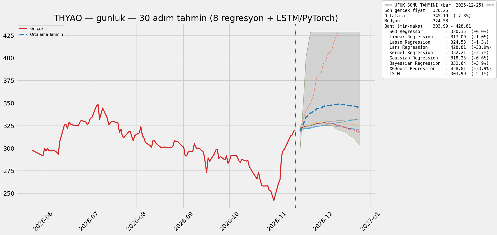

# 📈 Hisse Regresyon — Çoklu Model Fiyat Tahmini

Tek bir hisse senedi için **8 regresyon modeli + PyTorch LSTM** ile çok adımlı fiyat tahmini üreten, grafik ve CSV çıktısı veren bir Python projesi.

> 🧬 Bu proje, **InflationForecast** enflasyon tahmin projesindeki **model kadrosunun** hisse senedi piyasasına uyarlamasıdır. Regresyon modellerinin hiperparametreleri enflasyon projesiyle **birebir aynıdır**; LSTM ise aynı mimarinin **PyTorch** karşılığıdır.


---

## 🚀 Özellikler

- 🧠 **9 model**: SGD, Linear, Lasso, Lars, Kernel Ridge, Gaussian Process, Bayesian Ridge, XGBoost + LSTM (PyTorch)
- 📊 **Özyinelemeli çok adımlı tahmin** — her model kendi fiyat yolunu üretir, ortalama/medyan/bant raporlanır
- 🛡️ **Sağlamlaştırılmış tahmin yolu** — adım sınırı, ufuk zarfı ve medyan sürüşü ile uç sapmalar kontrol altında
- 📁 **Metastock CSV veri katmanı** — 60 dk / günlük / haftalık / aylık periyot desteği (`veri_periyot.py`)
- ⚡ **CPU/GPU otomatik** — CUDA varsa LSTM GPU'da eğitilir
- 📈 **Otomatik çıktılar** — özet panelli PNG grafik + tüm modellerin tahminlerini içeren CSV
- ✅ **Doğrulama raporu** — son 60 bar üzerinde tek-adım MAE, model bazında

---

## 🧠 Modeller

| # | Model | Tanım |
|---|-------|-------|
| 1 | **SGD Regressor** | `StandardScaler + SGDRegressor(max_iter=100000, tol=1e-6)` |
| 2 | **Linear Regression** | `LinearRegression()` |
| 3 | **Lasso Regression** | `Lasso(alpha=0.001)` |
| 4 | **Lars Regression** | `Lars(random_state=0)` |
| 5 | **Kernel Regression** | `KernelRidge()` (alpha=1, linear kernel) |
| 6 | **Gaussian Regression** | `GaussianProcessRegressor(kernel=DotProduct()+WhiteKernel())` |
| 7 | **Bayessian Regression** | `BayesianRidge()` |
| 8 | **XGBoost Regression** | `XGBRegressor(random_state=0)` |
| 9 | **LSTM (PyTorch)** | `LSTM(128) → Linear(64)+SELU → Linear(64)+ELU → Linear(1)`, RMSprop(0.01), 100 epoch, batch 32, **10 tohum ortalaması** |

---

## ⚙️ Kurulum

```bash
pip install pandas numpy scikit-learn xgboost matplotlib
```

PyTorch için (CUDA destekli kurulum önerilir):

```bash
# https://pytorch.org/get-started/locally/ adresinden sisteminize uygun komutu seçin
pip install torch
```

---

## 📂 Veri Kaynağı

Fiyat verisi **Metastock**'tan dışa aktarılmış CSV'lerden okunur (`veri_periyot.py` → `VeriPeriyot` sınıfı).

**Beklenen CSV formatları:**

| Periyot | Kolonlar | Örnek yol |
|---------|----------|-----------|
| 60 dk | `Date, Time, Open, High, Low, Close, Volume` | `metastock-60dk-csv/{HISSE}.csv` |
| Günlük | `Date, Open, High, Low, Close, Volume` | `metastock-gun-csv/{HISSE}.csv` |

> ⚠️ Varsayılan dizinler `D:\new\yeniden\...` şeklindedir. Kendi dizinleriniz için:

```python
# veri_periyot.py içindeki varsayılanları değiştirmeden, örnek kullanım:
vp = VeriPeriyot(
    csv_60dk_dizini=r"C:\veri\60dk-csv",
    csv_gunluk_dizini=r"C:\veri\gunluk-csv"
)
```

> 📌 **Not:** Fiyat verileri telif/lisans nedeniyle repoda **bulunmaz**; kendi veri export'unuzu kullanmanız gerekir.

---

## ▶️ Kullanım

```bash
# Varsayılan: THYAO, günlük, 30 adım
python hisse_tahmin.py

# Hisse + periyot + ufuk
python hisse_tahmin.py THYAO gunluk 30
python hisse_tahmin.py EDATA haftalik 12
python hisse_tahmin.py ASELS aylik 6
```

| Argüman | Varsayılan | Açıklama |
|---------|-----------|----------|
| `hisse` | `THYAO` | BIST ticker (büyük/küçük harf fark etmez) |
| `periyot` | `gunluk` | `gunluk`, `haftalik`, `aylik` |
| `ufuk` | `30` | Kaç bar ileri tahmin edileceği |

> 💡 Windows konsolunda emoji/Unicode sorunu yaşarsanız: `set PYTHONUTF8=1`

---

## 🧪 Yöntem

1. **Hedef değişken:** bir sonraki barın **getiri yüzdesi** (enflasyon projesindeki "aylık % değişim" mantığının karşılığı)
2. **Özellikler (21 adet):** getiri gecikmeleri (1–10), hacim değişim gecikmeleri (1–5), MA5/MA10/MA20/MA60 sapmaları, getiri volatilitesi (5 ve 20 bar)
3. **Eğitim/doğrulama:** kronolojik ayrım — son 60 bar doğrulama, model başına MAE raporu
4. **Çok adımlı tahmin:** özyinelemeli — tahmin edilen getiri fiyata eklenir, MA/volatilite simüle edilen yoldan yeniden hesaplanır
5. **Fiyat zincirleme:** `fiyat *= (1 + tahmin / 100)`
6. **Çıktı:** model başına fiyat yolu + Ortalama / Medyan / Maksimum / Minimum bandı

### 🛡️ Özyinelemeli tahminde sağlamlaştırma

| Guard | Kural | Amaç |
|-------|-------|------|
| Adım sınırı | Getiri ≤ tarihsel \|getiri\| 99. yüzdeliği | Uç tek-adım sapmalarını keser |
| Ufuk zarfı | Toplam sapma ≤ 2.5·σ·√ufuk | Bileşik patlamayı önler |
| Medyan sürüşü | Ortak fiyat yolu medyanla ilerler | Tek modelin sapması diğerlerini zehirlemesin |
| Gradyan kırpma | LSTM eğitiminde clip=1.0 | Ağırlık patlamasını önler |

> Bu guard'lar **model tanımlarını değiştirmez**; yalnızca tahmin yolunu sağlamlaştırır.

---

## 📊 Örnek Çıktı

`python hisse_tahmin.py THYAO gunluk 30` (son veri: 2026-11-13, kapanış 320.25):

```
=== UFUK SONU TAHMINI (bar: 2026-12-25) ===
Son gercek fiyat : 320.25
Ortalama         : 345.19  (+7.8%)
Medyan           : 324.53
Bant (min-maks)  : 303.99 - 428.81
  SGD Regressor         : 320.35  (+0.0%)
  Linear Regression     : 317.09  (-1.0%)
  Lasso Regression      : 324.53  (+1.3%)
  Lars Regression       : 428.81  (+33.9%)
  Kernel Regression     : 332.21  (+3.7%)
  Gaussian Regression   : 318.25  (-0.6%)
  Bayessian Regression  : 332.64  (+3.9%)
  XGBoost Regression    : 428.81  (+33.9%)
  LSTM                  : 303.99  (-5.1%)
```

**Doğrulama MAE (son 60 bar, tek adım):**

| Model | MAE |
|-------|-----|
| Linear / Lasso / Gaussian | **%1.705** |
| Kernel | %1.722 |
| Lars | %1.751 |
| Bayessian | %1.756 |
| SGD | %1.783 |
| XGBoost | %1.911 |
| LSTM | %2.201 |



---

## 📁 Dosya Yapısı

```
hisseregresyon/
├── hisse_tahmin.py                        # Ana betik: modeller, tahmin, çıktılar
├── veri_periyot.py                        # Veri katmanı (Metastock CSV → OHLCV, periyot dönüşümü)
├── README.md
├── grafikler/
│   └── THYAO_gunluk_tahmin.png            # Üretilen grafik (özet panelli)
└── THYAO_gunluk_tahmin.csv                # Üretilen tahmin tablosu
```

---

## ⚠️ Notlar ve Sınırlamalar

- 🚫 **Yatırım tavsiyesi değildir.** Çıktılar yalnızca araştırma/öğrenme amaçlıdır.
- 📉 Bazı modeller (özellikle **Lars** ve **XGBoost**) özyinelemeli modda agresif davranabilir; guard'lar bunları zarf içinde tutar — grafikte zarf tavanına yapışık görünebilirler.
- 🧮 2000+ örnekte GPR `optimizer=None` ile çalışır (O(n³) L-BFGS pratik değil); kernel parametreleri başlangıç değerinde kalır.
- ⏱️ LSTM 10 tohumla eğitildiği için ilk çalıştırma 3–10 dk sürebilir (donanıma göre).
- 📅 Tahmin kalitesi veri export'unuzun güncelliğine bağlıdır.

---

## 📜 Lisans

Bu proje için henüz bir lisans belirtilmemiştir. Kullanmadan önce depo sahibiyle iletişime geçin.

